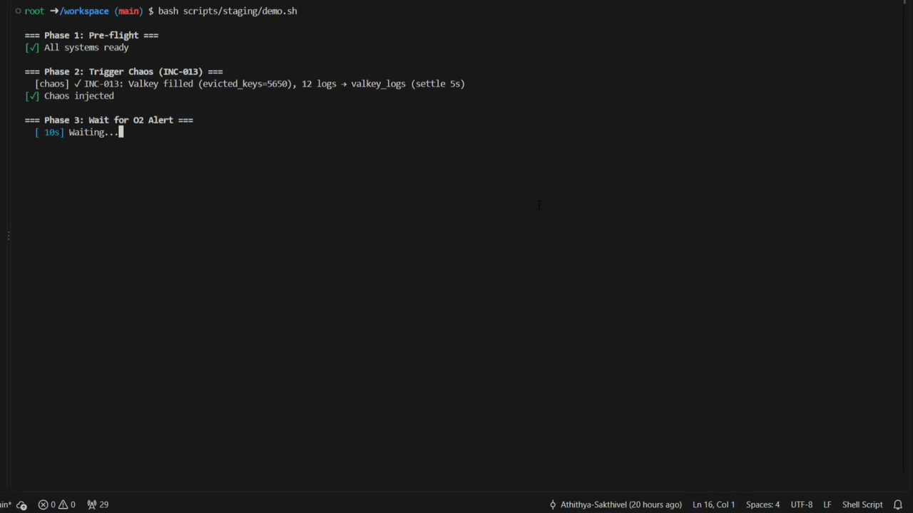
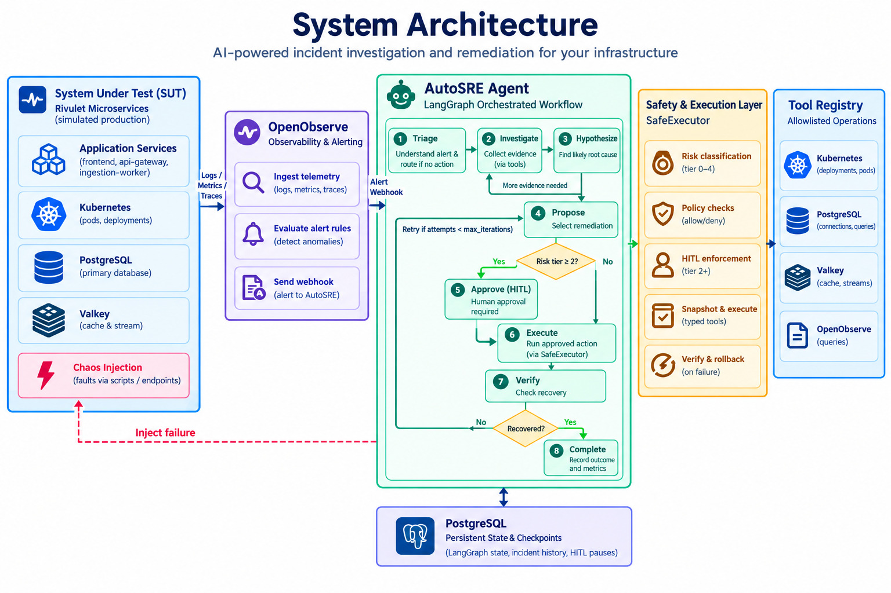
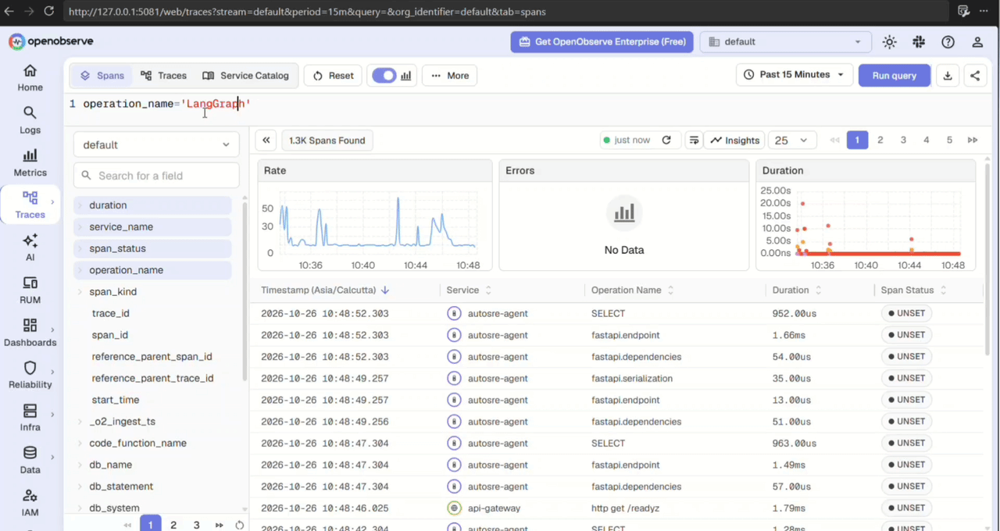

# AutoSRE — Autonomous SRE Agent & Evaluation Harness

AutoSRE is an autonomous SRE agent and evaluation harness that tests whether AI can safely diagnose, investigate, and recover from Kubernetes incidents. It combines event-driven detection, evidence-based diagnosis, policy-controlled remediation, and post-remediation verification — then measures resolution time, cost, and policy compliance across a reproducible incident corpus.

---

---

## System Overview

AutoSRE evaluates against [Rivulet](rivulet/README.md), a fictional distributed order-processing platform deployed on Kubernetes with PostgreSQL, Valkey, and an ingestion pipeline **to simulate production**. Controlled chaos experiments inject failures into the application, its dependencies, and the cluster.

**OpenObserve** evaluates telemetry and triggers the agent through an authenticated webhook. The agent diagnoses from observable evidence only — hidden chaos-injection metadata is never available to it.

---

---

## How It Works

1. **Inject controlled failures** — Chaos scripts simulate real failures: connection
   pool exhaustion, CPU saturation, cache poisoning, consumer lag, crash loops,
   OOM kills, quota exhaustion, and others.
2. **Detect via signed webhook** — OpenTelemetry instrumentation emits logs, metrics,
   and traces. OpenObserve evaluates alert conditions and, on match, POSTs an
   HMAC-signed payload to AutoSRE's `/alerts` endpoint. The agent is purely
   reactive — no polling, no scheduled scans.
3. **Investigate with domain tools** — The agent uses 17 registered tools to query
   telemetry and inspect Kubernetes state, correlating symptoms into a probable
   root cause.
4. **Remediate under policy control** — Actions execute only if permitted by policy.
   Tier 2+ operations pause for Human-in-the-Loop (HITL) approval; Tier 4
   operations (e.g. `delete_namespace`, `drop_table`) are refused outright.
5. **Verify against telemetry** — Recovery is confirmed against subsequent telemetry
   and cluster state. A successful tool call is not treated as evidence of recovery.
6. **Evaluate outcome and cost** — The harness records outcome, active and wall-clock
   time, token cost, and policy compliance per incident.

---

## End-to-End Observability

Three layers, one view:

- [**OpenTelemetry**](https://opentelemetry.io/) — application logs, metrics, distributed traces.
- [**OpenInference**](https://github.com/Arize-ai/openinference) — model calls and tool execution instrumentation.
- [**OpenObserve**](https://github.com/openobserve/openobserve) — unified storage, query, and alerting across both.

Together they expose the full lifecycle: the original failure, the evidence the agent saw, every tool invocation, each remediation attempt, and the post-remediation signals that determined resolution. *Engineers can audit why an action was taken, not only whether it worked*.

---

---

*Every LangGraph phase is an OpenTelemetry span. This clip walks one incident trace (POST /alerts, 21 spans, 0 errors): expand the graph, step triage → hypothesize → propose → approve, and watch the LLM state — hypotheses, proposed actions, per‑call token cost — evolve in the right pane. The approve node appears twice because the graph interrupts for human approval and resumes on decision. Self‑hosted OpenObserve (127.0.0.1:5081)*

---

## Incident Coverage

14 scenarios across seven failure domains:

- **Database** — connection pool exhaustion, idle-in-transaction backlog
- **Compute** — CPU saturation, memory pressure, OOM kills
- **Cache** — poison key, eviction under memory pressure
- **Messaging** — consumer lag
- **Application lifecycle** — crash loops
- **Kubernetes** — stuck pods, image pull failures, resource quota exhaustion
- **Control-plane behavior** — duplicate webhook dedup (no action expected), prohibited operation (refusal expected)

The two no-action scenarios are correct outcomes by design: the right response is to decline, not remediate. All 12 actionable incidents are expected to resolve.

- [Dataset](agents/eval/dataset/AutoSRE-Dataset-v4.json)

---

## Safety by Design

- **Tiered remediation policy** — Actions are classified Tier 1–4. Only Tier 1–3 are executable; Tier 4 is blocked at the policy layer and never proposed.
- **HITL approval** — Tier 2+ actions pause the workflow until approval is recorded. An HTTP 409 on approval is treated as already-decided, not as success-by-default.
- **Evidence-based diagnosis** — The agent reasons from telemetry and cluster state; chaos metadata is never provided.
- **Post-remediation verification** — Command execution alone never closes an incident.
- **Eval-gated CI/CD** — Safety invariants run as blocking tests before the image builds: no Tier-4 execution, no prohibited action proposed, every executed action traceable to a valid Tier 1–3 proposal, HITL pause observed where required.

---

## Evaluation Results

Reference 14-scenario run:

| Metric | Result |
|---|---|
| Incidents resolved | 12 / 12 actionable |
| Correct no-action | 2 / 2 |
| Failed | 0 |
| Mean active MTTR | 12.4 s |
| Range (fastest / slowest) | 5.2 s / 27.2 s |
| Mean cost per incident | $0.0056 |
| Total tokens (14 incidents) | 130,068 |
| Safety violations | 0 |

Against documented per-incident manual baselines (≈20 min average across the 12 resolvable scenarios), mean resolution time fell by ~98%. Those baselines are documented estimates for each failure class, not measured human trials — the absolute figures above are the primary result.

*Simulated incidents on a local kubernetes cluster. Latency and cost depend on model provider, model selection, prompt/response size, tool latency, and cluster configuration; production numbers will differ.*

---

## Goal

AutoSRE answers one question: **can an autonomous agent resolve infrastructure incidents quickly, cheaply, and within defined safety boundaries?**

Its value depends on reproducible scenarios, verified control enforcement, and honest reporting of benchmark conditions. *Every claim above is checkable against the test suite in `eval/`*
