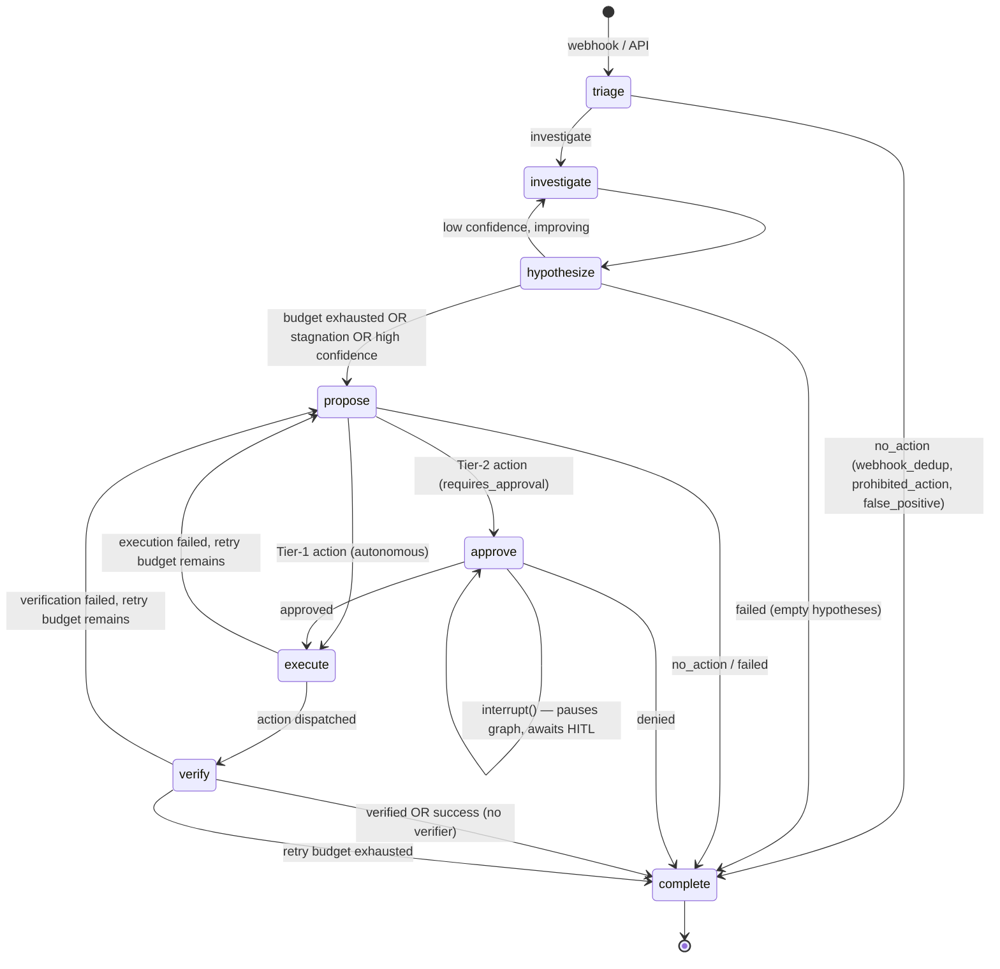
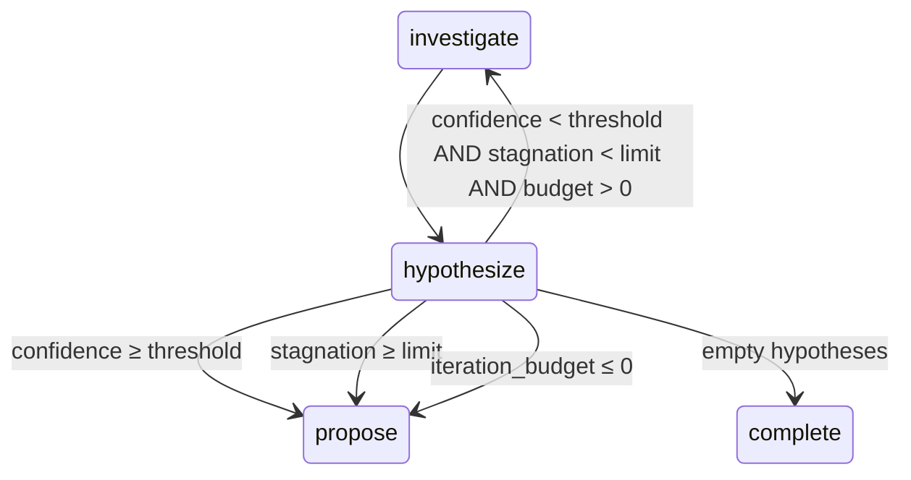

# AutoSRE Agent DAG

> The agent is a LangGraph-compiled state machine that investigates Kubernetes
> incidents, decides on remediation, gates destructive actions through human
> approval, and dispatches them through a policy-enforced executor. Every node
> is a pure function of `AgentState` + `RunnableConfig`; all infrastructure is
> injected via `config['configurable']['graph_context']`.

---

## 1. High-Level Flow



The graph is a **DAG with two loops**: the
`investigate → hypothesize → investigate` confidence-refinement loop, and the
`execute → propose → execute` retry loop bounded by `max_action_attempts`.

---

## 2. Nodes

| Node | Responsibility | Key behaviours |
|------|----------------|----------------|
| `triage_node` | Generate 2–3 initial hypotheses from alert metadata. | **Early exit** for no-action categories (`webhook_dedup`, `prohibited_action`, `false_positive`) before any LLM call. |
| `investigate_node` | Select and execute Tier-0 read-only tools to gather evidence. | LLM selects tools; on LLM failure, deterministically runs **every** available Tier-0 tool with sensible defaults. Bounded by `_MAX_TOOLS_PER_ITERATION`. |
| `hypothesize_node` | Refine hypothesis confidence based on accumulated evidence. | Routes to `investigate` (low, improving), `propose` (high / stagnation / budget exhausted), or `complete` (empty hypotheses). |
| `propose_node` | Decide the remediation action. | Three resolution paths: (1) LLM proposal, (2) LLM-failed fallback, (3) LLM-returned-`none` fallback. Applies category-forbidden-tool check, namespace clamp, and schema guard before returning. |
| `approve_node` | Gate Tier-2 actions with human approval. | **Two-pass design**: first pass records `approval_requested_at`, second pass calls `interrupt()` (pauses graph), third pass receives the resume decision and computes `approval_wait_seconds`. |
| `execute_node` | Dispatch the proposed action through `SafeExecutor`. | When `approval_granted` is `True`, downgrades `risk_tier → 1` and `requires_approval → False` so the executor's policy engine doesn't re-trigger the HITL gate. |
| `verify_node` | Post-execution verification and retry routing. | Routes to `complete` on verified success; routes back to `propose` on failure or `verification_passed=False`, up to `max_action_attempts`. |
| `complete_node` | Compute final metrics and set terminal status. | Derives `status` from executed actions (`resolved` / `failed` / `no_action` / `running`), computes `wall_clock_seconds`, `active_seconds`, `backoff_seconds`, `approval_wait_seconds`. |

### 2.1 Node I/O Contract

Every node is typed:

```python
async def some_node(state: AgentState, config: RunnableConfig) -> dict[str, Any]
```

It returns a **partial state dict** that LangGraph merges into the existing
state. A node never mutates `state` directly; it only returns the fields it
wants to update.

### 2.2 Injected Context

All cross-cutting dependencies are available on
`config['configurable']['graph_context']`:

| Field | Type | Used by |
|-------|------|---------|
| `llm_router` | `TokenVelocityRouter` | `triage`, `investigate`, `hypothesize`, `propose` |
| `registry` | `ToolRegistry` | `investigate`, `propose` |
| `executor` | `SafeExecutor` | `execute` |
| `llm_config` | `LLMConfig` | cost calculation (`_accumulate_usage`) |
| `confidence_propose` | `float` | `propose` (fallback threshold) |
| `max_action_attempts` | `int` | `propose`, `verify` |
| `stagnation_limit` | `int` | `hypothesize` |

---

## 3. Routing Logic

### 3.1 Confidence-refinement loop (`investigate ↔ hypothesize`)



`hypothesize_node` never routes to `complete` on low confidence — it always
falls forward to `propose`, which is where the category-based fallbacks live.
This guarantees that even a completely failed investigation gets a remediation
attempt via `FALLBACK_ACTIONS`.

### 3.2 Proposal routing (Tier 1 vs Tier 2)

`propose_node` returns one of three phases:

```python
{
    "current_phase": PHASE_APPROVE if requires_approval else PHASE_EXECUTE,
    ...
}
```

- **Tier 1** (`risk_tier == 1`): routes to `execute` directly.
- **Tier 2** (`risk_tier == 2`): routes to `approve`, which must call
  `interrupt()` before routing to `execute`.

### 3.3 Post-execution routing

`execute_node` routes to:

- `PHASE_VERIFY` on successful dispatch (tool returned without error), or
- `PHASE_PROPOSE` on dispatch failure (re-try a different action).

`verify_node` routes to:

- `PHASE_COMPLETE` if `verification_passed is True`, or `success is True` with
  no verifier registered, or `max_action_attempts` exhausted.
- `PHASE_PROPOSE` if verification failed or the attempt budget remains.

---

## 4. State Shape

`AgentState` is a typed dict with the following key fields:

| Field | Type | Writer(s) | Reader(s) |
|-------|------|-----------|-----------|
| `incident_id` | `str` | API layer | all nodes |
| `incident_metadata` | `dict` | API layer | `triage`, `investigate`, `propose` |
| `current_phase` | `str` | every node | routing functions |
| `status` | `str` | `complete_node` | API layer |
| `hypotheses` | `list[dict]` | `triage`, `investigate`, `hypothesize` | `investigate`, `hypothesize`, `propose` |
| `iteration_budget` | `int` | `triage`, `investigate`, `hypothesize` | `investigate`, `hypothesize` |
| `iteration_count` | `int` | `investigate` | `hypothesize` |
| `last_top_confidence` | `float` | `hypothesize` | `hypothesize` |
| `stagnation_count` | `int` | `hypothesize` | `hypothesize` |
| `proposed_actions` | `list[dict]` | `propose`, `approve` | `approve`, `execute` |
| `requires_human_approval` | `bool` | `propose` | `complete`, `approve` |
| `approval_requested_at` | `float` | `approve` (pass 1) | `approve` (pass 2) |
| `approval_granted` | `bool \| None` | `approve` | `complete`, `execute` |
| `approval_wait_seconds` | `float` | `approve` | `complete` |
| `executed_actions` | `list[dict]` | `execute` | `propose`, `verify`, `complete` |
| `action_attempts` | `int` | `execute` | `propose`, `verify` |
| `tokens_used`, `prompt_tokens`, `completion_tokens`, `cost_usd`, `estimated_paid_cost_usd`, `model_usage` | cost fields | every node via `_accumulate_usage` | `complete`, metrics API |
| `wall_clock_seconds`, `active_seconds`, `backoff_seconds`, `llm_latency_seconds` | timing fields | `complete` | metrics API |

---

## 5. Safety Boundaries

The graph enforces four independent safety layers. A remediation action must
pass **all four** to reach `execute_node`.

### 5.1 Namespace Clamp (`_clamp_namespace`)

For every K8s tool (`restart_deployment`, `scale_deployment`, `delete_pod`,
`list_pods`, `get_pod_events`, `get_pod_logs`, `get_deployment_status`,
`get_pod_metrics`), `tool_args["namespace"]` is forcibly overwritten with the
incident's namespace. Non-K8s tools (postgres, valkey, observability) are
excluded — their input models have `extra="forbid"` and would reject the
injected field.

### 5.2 Category-Forbidden Tools (`_CATEGORY_FORBIDDEN_TOOLS`)

A static map from incident category to tools that must never be used for that
category, mirroring the dataset's `must_not_do` evaluation criteria. Checked
in `propose_node` for both the LLM path and the fallback paths. A forbidden
proposal raises `ValueError`, which routes to the fallback path.

```python
_CATEGORY_FORBIDDEN_TOOLS = {
    "cache_eviction":           frozenset({"restart_deployment"}),
    "db_connection_exhaustion": frozenset({"restart_deployment"}),
    "cpu_saturation":           frozenset({"restart_deployment", "delete_pod"}),
    "pod_oom":                  frozenset({"scale_deployment"}),
    "memory_pressure":          frozenset({"scale_deployment"}),
}
```

### 5.3 Schema Guard (`_args_satisfy_schema`)

Before `propose_node` returns, it validates `tool_args` against the tool's
Pydantic `input_model`. A schema-invalid action returns
`status="no_action"` rather than dispatching a doomed call that would waste an
attempt and report as `status="failed"`. This guard catches LLM hallucinated
fields (e.g. adding `namespace` to `flush_all`, which `FlushAllInput` forbids).

### 5.4 Executor Policy Engine (`SafeExecutor`)

`SafeExecutor` independently classifies every dispatch via `PolicyEngine`:

| Step | Behaviour |
|------|-----------|
| Step 2 | `effective_tier = max(registered_tier, proposed_tier)` — proposals cannot downgrade a tool's registered risk. |
| Step 3 | `classify()` raises `PolicyRejectionError` for Tier-4 actions. |
| Step 4a | If `action.requires_approval=True` but policy says no, upgrade to `requires_approval=True`. |
| Step 4b | If `action.requires_approval=False` (because `approve_node` already granted) but policy says yes, **downgrade** to `requires_approval=False`. This is the graph-authority path. |
| Step 6 | If `decision.requires_approval` is still `True`, raise `NeedsApprovalError`. |

---

## 6. Failure Modes and Recovery

| Failure | Where caught | Recovery |
|---------|--------------|----------|
| LLM quota / budget exhausted | `LLMBudgetExhaustedError` | Every node routes to the next phase with deterministic fallbacks; `propose_node` uses `FALLBACK_ACTIONS`. |
| LLM returns malformed JSON | `parse_json_response` | Raises, caught by `except` blocks; node falls through to next phase. |
| Tier-0 tool fails during investigation | `ToolExecutionError` | Logged as failed evidence; investigation continues with other tools. |
| Hypothesis confidence stalls | `stagnation_count >= limit` | `hypothesize_node` routes to `propose` for fallback. |
| Action execution fails | `executor.execute` raises | `execute_node` routes back to `propose` if attempts remain. |
| Verification fails | `verification_passed=False` | `verify_node` routes back to `propose` if attempts remain. |
| Retry budget exhausted | `action_attempts >= max_action_attempts` | Routes to `complete` with `status="failed"`. |
| HITL approval denied | `decision.approved=False` | `approve_node` routes to `complete` with `status="no_action"`. |
| Tool args fail schema | `_args_satisfy_schema` | `propose_node` returns `status="no_action"` cleanly. |

---

## 7. Two-Pass HITL Approval

`approve_node` uses a two-pass design to measure the actual wall-clock time
the graph spent waiting for human approval, so `active_seconds` can subtract
it and report true agent work time.

```
Pass 1: approval_requested_at is None
    → set approval_requested_at = time.time()
    → return current_phase = PHASE_APPROVE (re-enters self)

Pass 2: approval_requested_at is set, approval_granted is None
    → call interrupt(payload) — graph PAUSES here
    → returns when the API resumes the thread with a decision

Pass 3: approval_granted is set (from pass 2)
    → route to execute (approved) or complete (denied)
```

`approval_wait_seconds = time.time() - approval_requested_at` is recorded on
`RunMetrics` so `complete_node` can subtract it from `wall_clock_seconds`.

---

## 8. Deterministic Fallbacks

When the LLM is unavailable or returns low-confidence hypotheses,
`propose_node` falls through to `FALLBACK_ACTIONS`:

```python
FALLBACK_ACTIONS = {
    # Tier 0 — no action
    "webhook_dedup":       {"tool_name": "none", ...},
    "false_positive":      {"tool_name": "none", ...},
    "prohibited_action":   {"tool_name": "none", ...},

    # Tier 1 — autonomous
    "crash_loop":          {"tool_name": "restart_deployment", ...},
    "memory_pressure":     {"tool_name": "restart_deployment", ...},
    "pod_oom":             {"tool_name": "restart_deployment", ...},
    "stale_pod":           {"tool_name": "restart_deployment", ...},
    "image_pull_error":    {"tool_name": "restart_deployment", ...},
    "http_errors":         {"tool_name": "restart_deployment", ...},
    "db_connection_exhaustion": {"tool_name": "terminate_backend", ...},
    "cache_poison_key":    {"tool_name": "delete_valkey_key", ...},
    "consumer_lag":        {"tool_name": "restart_deployment", ...},
    "cascading_failure":   {"tool_name": "restart_deployment", ...},

    # Tier 2 — HITL required
    "cpu_saturation":      {"tool_name": "scale_deployment", "replicas": 4, ...},
    "cache_eviction":      {"tool_name": "flush_all", ...},
    "resource_quota":      {"tool_name": "scale_deployment", "replicas": 2, ...},
}
```

`_build_fallback_args` fills `name`, `namespace`, and `replicas` from incident
metadata so the schema guard accepts the result without LLM intervention.

---

## 9. Metrics and Observability

Every LLM call is tracked by `_accumulate_usage`:

- `tokens_used`, `prompt_tokens`, `completion_tokens` — cumulative.
- `cost_usd` — actual cost (often `$0.00` on free tier).
- `estimated_paid_cost_usd` — what this would cost on the paid tier.
- `model_usage` — per-model call counts and token totals.

The `[TOKEN_TRACK]` log line is emitted to **both** the structured logger and
`sys.stderr` so it's visible in test harness output regardless of log level.

Every tool dispatch is traced via OpenTelemetry spans with OpenInference
attributes, and sensitive fields (passwords, tokens, API keys) are scrubbed
before being written to span attributes.

---

## 10. File Layout

| File | Role |
|------|------|
| `src/autosre/core/graph_nodes.py` | Node implementations (this DAG) |
| `src/autosre/core/graph.py` | `StateGraph` assembly and compilation |
| `src/autosre/core/state.py` | `AgentState`, `ProposedAction`, `SREContext`, `RunMetrics` |
| `src/autosre/core/graph_helpers.py` | Phase constants, shared helpers |
| `src/autosre/core/router.py` | `TokenVelocityRouter` (multi-model with fallbacks) |
| `src/autosre/safety/executor.py` | `SafeExecutor` with policy gate |
| `src/autosre/safety/policy.py` | `PolicyEngine`, `PolicyDecision`, `RiskTier` |
| `src/autosre/tools/{k8s,postgres,valkey,observability,registry}.py` | Tool implementations |
| `src/autosre/api/runner.py` | `LangGraphRunner` — the orchestration wrapper |

---

## 11. Invariants

These are non-negotiable properties the graph maintains:

1. **Terminal status is always set.** `complete_node` runs for every
   incident; `status` is always one of `resolved`, `failed`, `no_action`,
   `running`.
2. **No Tier-4 action is ever dispatched.** The policy engine's Step 3
   raises `PolicyRejectionError` before any snapshot or dispatch.
3. **Namespace is always the incident's namespace** for K8s tools.
4. **`active_seconds ≤ wall_clock_seconds`.** `active_seconds` subtracts
   `backoff_seconds` and `approval_wait_seconds`; it never exceeds
   wall-clock.
5. **A forbidden-tool proposal never reaches the executor.** It is
   rejected in `propose_node` before returning.
6. **Schema-invalid args never reach the executor.** `_args_satisfy_schema`
   catches them in `propose_node`.
7. **The retry budget is finite.** `max_action_attempts` bounds the
   `execute → propose → execute` loop.
8. **Tier-2 actions always pause for HITL.** `approve_node` calls
   `interrupt()` unconditionally when `requires_human_approval=True`.
